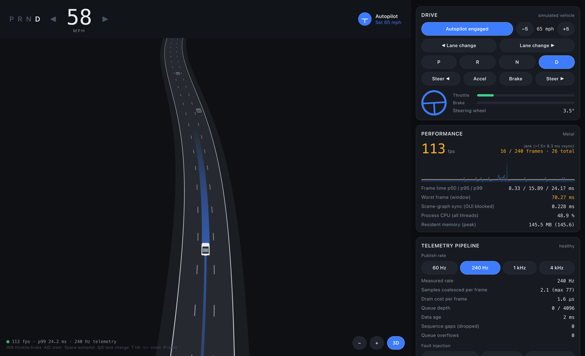
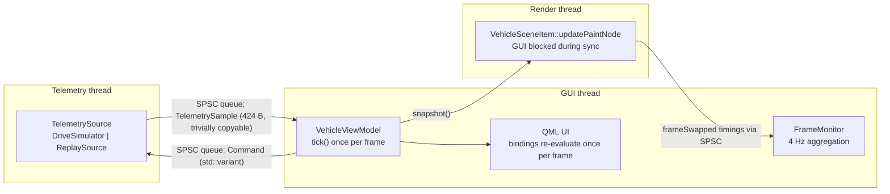

<div align="center">

# Reality View Native

**A native C++20 / Qt 6 real-time vehicle visualization, driven by a simulated telemetry stack.**

[](https://github.com/jchacker5/reality-view-native/actions/workflows/ci.yml)
[](LICENSE)




</div>

Reality View Native is the native companion to
[Open Tesla Reality View](https://github.com/jchacker5/open-tesla-reality-view), which rebuilds
dashcam drives as 3D Gaussian splats in the browser. This project asks a different question:
what does the *in-car* side of that look like, built the way an embedded vehicle UI is built?
It uses C++, Qt Quick, a lock-free telemetry pipeline, direct scene-graph rendering, and numbers
for every performance claim.

> Not affiliated with or endorsed by Tesla, Inc. All vehicle data is simulated.

## What it does

- **Real-time vehicle visualization** rendered straight into the Qt Quick scene graph (no
  QPainter, no Canvas). It draws a heading-up chase camera with a perspective tilt, a procedural
  three-lane highway, traffic, the planned-path ribbon, a fading trail, and the ego car with
  steered wheels, brake lights and blinking turn signals.
- **Simulated telemetry stack** on its own thread: a kinematic bicycle model, a driver-assist
  controller (pure-pursuit lane keeping plus IDM adaptive cruise), signal-triggered automatic
  lane changes, and background traffic that follows the same car-following law.
- **Thread-safe asynchronous pipeline**: producer thread → wait-free SPSC ring buffer → GUI
  thread, which drains once per vsync. Commands travel back through a second SPSC queue as a
  `std::variant`. There is no mutex on any per-sample path.
- **Interactive controls**: engage or disengage Autopilot, set the cruise speed, change lanes,
  shift gears, or drive manually with the keyboard or on-screen pedals. Braking or steering
  past a threshold disengages the assist, as in a real L2 system.
- **Fault injection you can watch**: stall the producer for 500 ms or 3 s, drop 30% of samples,
  or push 4 kHz telemetry. The UI keeps rendering at full rate, flags stale data, and counts
  sequence gaps and queue overflows.
- **Built-in instrumentation**: frame-time p50/p95/p99, jank against the display's real refresh
  interval, GUI-thread sync cost, process CPU and RSS, all measured live.
- **Replay** recorded drives from CSV (`--replay`), with a headless recorder tool.
- **Benchmarks, 10 test suites, sanitizers and CI** on Linux and macOS.

## Measured performance

Apple M4, 120 Hz ProMotion display, Release build, Metal backend. Reproduce with
`reality-view-native --benchmark-seconds 8`:

| Metric | 240 Hz telemetry | 4 kHz telemetry |
|---|---:|---:|
| Average frame rate | 110–117 fps (120 Hz display) | 111 fps |
| Frame time p50 | 8.3 ms | 8.3 ms |
| Scene-graph sync (GUI thread blocked) | 0.19 ms | 0.09 ms |
| Resident memory | ~146 MB | ~146 MB |

Raising the telemetry rate 16× does not change the frame rate. That is the point of
once-per-frame coalescing. On a 60 Hz display the app holds 60 fps with large headroom. On
120 Hz, roughly 5% of frames still miss the 8.3 ms deadline even though our sync costs 0.2 ms;
[docs/PERFORMANCE.md](docs/PERFORMANCE.md) covers how to investigate that and what is ruled out.

Hot paths (`rvn_bench`, median of 7):

| Benchmark | Time |
|---|---:|
| SPSC ring buffer, 2 threads | **159 M items/s** (24× a mutex + deque) |
| Simulator step (7 agents, ACC + pure pursuit) | 444 ns |
| Road projection, hinted vs brute force (20 km) | 226 ns vs 38 µs |
| Consumer drain of 17 samples | 299 ns |
| Road mesh rebuild, 800 m (26k vertices, every 150 m) | 101 µs |
| Per-frame dynamic meshes (8 cars + ego) | 1.0 µs |

## Quick start

```sh
# macOS
brew install qt cmake ninja
# Ubuntu 24.04 (or use the Qt online installer for 6.8+)
sudo apt install qt6-base-dev qt6-declarative-dev cmake ninja-build

cmake --preset dev
cmake --build --preset dev
ctest --preset dev

./build/dev/src/app/reality-view-native.app/Contents/MacOS/reality-view-native   # macOS
./build/dev/src/app/reality-view-native                                           # Linux
```

| Flag | Effect |
|---|---|
| `--rate <hz>` | Telemetry publish rate, 10–4000 Hz (default 240) |
| `--seed <n>` | Road and traffic seed |
| `--replay <file.csv>` | Replay a recorded drive instead of simulating (try `samples/sample-drive.csv`) |
| `--benchmark-seconds <n>` | Run, print frame statistics as JSON, exit |
| `--screenshot <file.png>` | Save a screenshot after 3 s, exit |

**Keys:** `W`/`S` throttle and brake · `A`/`D` steer · `Space` Autopilot · `Q`/`E` lane change ·
`[`/`]` cruise speed · `T` 2D/3D · `+`/`−` zoom · `R` reset.

## Architecture



- `src/core/` is a **Qt-free C++20 library**: simulation, pipeline, statistics and mesh
  generation. Everything there is unit-tested, benchmarked, and built under ASan, UBSan and
  TSan without a GUI.
- `src/app/` is the **Qt layer**: a view model, a custom `QQuickItem` renderer, a sparkline
  item, the frame monitor, and QML.

[docs/ARCHITECTURE.md](docs/ARCHITECTURE.md) covers the threading model, ownership and
lifetimes, rendering pipeline, failure modes, and the trade-offs behind each decision.
[docs/DESIGN_QA.md](docs/DESIGN_QA.md) answers the design questions this project is built to
discuss.

## Testing

| Suite | What it proves |
|---|---|
| `tst_spsc_ring_buffer` | FIFO, full and empty edges, wrap-around, 2M items across 2 threads in order (run under TSan) |
| `tst_telemetry_pipeline` | No gaps when healthy; `stop()` interrupts a 10 s stall; consumer never blocks during a stall; dropout and overflow are detected as sequence gaps |
| `tst_drive_simulator` | Lane keeping over 2 min within 0.5 m, ACC never closer than 2 m, lane change and auto-cancel, driver override, gear interlocks, determinism |
| `tst_vehicle_model` | Braking never reverses, rate-limited steering, turning radius matches L / tan δ |
| `tst_road` | Seed determinism, smoothness, hinted projection == brute force |
| `tst_scene_geometry` | Premultiplied alpha, floating origin keeps vertices small at 55 km, degenerate input yields no NaNs |
| `tst_telemetry_csv` | Bit-exact round trip; malformed input rejected with the right line number |
| `tst_frame_stats`, `tst_geometry` | Percentiles, jank, sliding window; transforms and lat/lon |
| `tst_ui_smoke` | Boots the real QML UI headless (offscreen + null RHI) and fails on any QML warning; frames render; commands round-trip; a stalled producer does not stall rendering |

CI runs the full build and tests on Ubuntu and macOS with `-Werror`, sanitizer jobs for the
core, a pinned clang-format check, and publishes benchmark results to the job summary.

## License

MIT © Joseph Defendre
